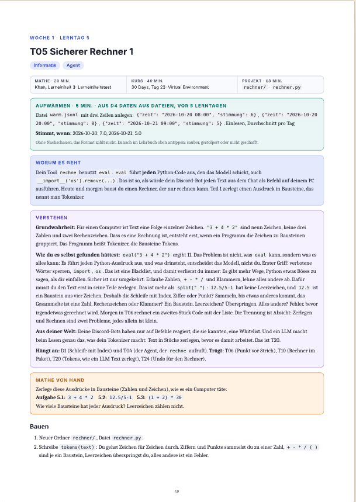

# Private Lab

## Moin.
>Ich bin **Lennox**, 21 Jahre alt und möchte im Alleingang alles über Neuronale Netzwerke, Algorithmen, Elektrotechnik, ML, Automatisierungen und Python lernen.

#### Hintergrund:
- Mit 12 wollte ich einen großen Minecraft-Server mit meinen Freunden bauen, mithilfe eines Buches und eines damals schon viel zu alten Laptops. Es scheiterte bereits am Localhost.
- 2 Jahre später wurde dieser Traum wieder aufgenommen und ich habe erste Minecraft-Plugins in Java geschrieben.
- 2021 fing ich an, Discord-Bots in Node.js und discord.js/v14 zu coden.
- Ein Jahr später fing ich eine schulische Ausbildung als Informationstechnischer Assistent (kurz: ITA) an.
- 2024 startete ich meine Ausbildung als Fachinformatiker bei Computacenter, beendete diese aber nie.
>In den letzten 2 Jahren verlor ich den Bezug zu meiner Leidenschaft. Anfang April 2026 fing ich wieder an, Systeme, Automationen, Plugins und Weiteres zu bauen. Daraus ist das Interesse für **Artificial Intelligence** entstanden, und somit sind wir hier.

# Inhaltsverzeichnis
| Name | Was? |
| --- | --- |
| [30 Days of Python](/30-days-of-python/) | Python-Grundlagen lernen |
| [Datenblock](/datenblock/Datenblock.md) | Python-Datenverarbeitung, Vertiefung |
| [Agent](/agent/Agent.md) | Erster mit Python geschriebener AI Agent (verknüpft mit Gemini) |
| [Rechner](/rechner/Rechner.md) | Funktionen für den Agent |
| [Auswertung](/tracker/auswertung.py) | Auswertung aus `.jsonl`, Datensatz ähnlich wie mein privater Habit Tracker |

# Was ich nutze:
- **Software:**
    - Claude Max 5x (erklärt sich von selbst 😉)
    - Visual Studio Code ➔ *Programmierung*
    - Tailscale ➔ *P2P-Netzwerk, um den Pi zu erreichen*
    - Khan Academy ➔ *Algebra-Grundlagen*
    - GitHub ➔ *Projekt-Speicher*

- **Hardware:**
    - MacBook Air 15", M3, 2024 ➔ *Hier arbeite ich*
    - Raspberry Pi 3B+ ➔ *Server, auf dem Claude-Code-Routinen, Dashboard und weitere Dienste laufen*
    - ESP32-S3 ➔ *Modul für meine Projekte*

# Wie ich lerne:
**Mike**, mein persönlicher Assistent, läuft über Routinen und ein Dashboard, gehostet auf dem Pi.

Er basiert auf Claude Code, Gemini und der Google TTS API. Über seinen verknüpften Datenspeicher, sein „Gehirn“, kennt er so gut wie mein ganzes Leben. Von der Einkaufsliste bis zu meinem Werdegang organisiert er alles. Er spricht mit eigener Stimme und schreibt sein Gedächtnis selbst weiter: Was er über mich lernt, merkt er sich, ohne dass ich es ihm jedes Mal neu erklären muss.

Zum Lernen nutze ich ein Lehrbuch, das Mike geschrieben hat (Shoutouts an Anthropic), und einen Tutor-Skill, der in Mike eingebaut ist.

### Beispiel:
